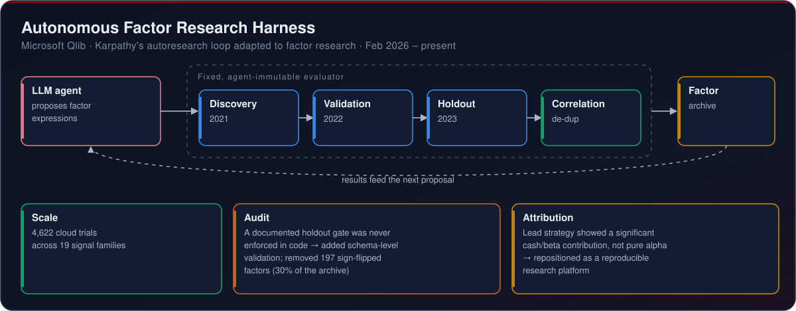
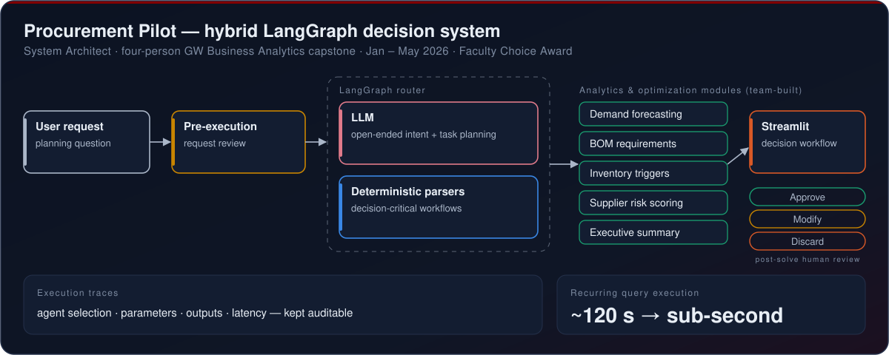
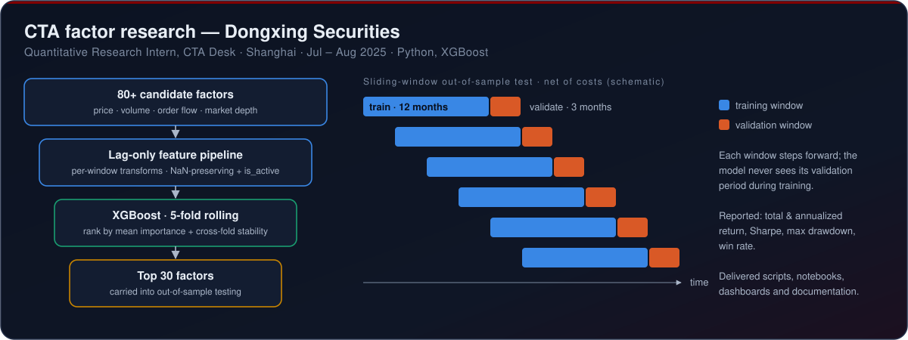
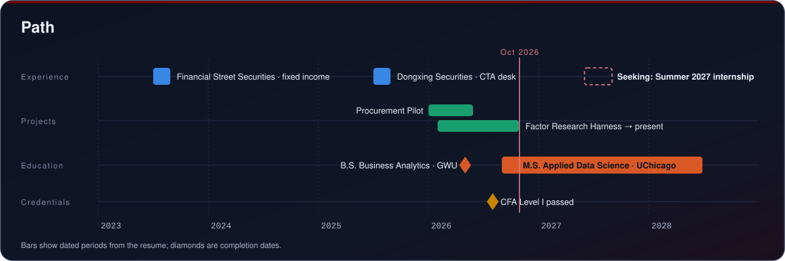

  

### Finance × data science — factor research, leakage-safe ML validation and AI research tooling | MS in Applied Data Science, University of Chicago (expected June 2028)

Most of my work is about making sure a signal is real before anyone trusts it: lag-only features that can't see the future, rolling out-of-sample validation, evaluators the model can't edit, and attribution that separates beta from alpha.

I've done that on **Dongxing Securities' CTA desk**, where I screened 80+ alpha factors on Chinese equity-index futures, and in my own **Autonomous Factor Research Harness**, where an LLM agent proposes factors and a fixed evaluator decides whether they survive. Before that I did fixed-income due diligence at **Financial Street Securities**. I hold a **B.S. in Business Analytics with a finance concentration from George Washington University** (magna cum laude, 3.74), I've **passed CFA Level I**, and I'm now in the **2-year thesis track of UChicago's MS in Applied Data Science** on a merit scholarship.

I'm looking for **Summer 2027 internships** in quantitative research, investment data science and finance-focused machine learning.

## At a glance

## How I work

| Research discipline | Engineering |
| --- | --- |
| Lag-only feature pipelines with per-window transforms, so nothing looks ahead | LLM agents for open-ended work, deterministic tools for decision-critical steps |
| Rolling and sliding-window out-of-sample validation, net of costs | Agent-immutable evaluators with time-separated discovery, validation and holdout gates |
| Structural vs. technical missingness kept apart (NaN-preserving, `is_active` flags) | Schema-level validation that enforces in code what the docs only promise |
| Performance attribution that checks for cash/beta before calling anything alpha | Human-in-the-loop review: pre-execution checks, approve / modify / discard, execution traces |

## Selected work

### Autonomous Factor Research Harness · Microsoft Qlib · Feb 2026 – present

- Adapted Karpathy's autoresearch loop to quantitative factor research: an LLM agent proposes factor expressions, and a fixed evaluator the agent can't modify enforces time-separated **discovery (2021), validation (2022) and holdout (2023)** gates plus correlation de-duplication.
- Ran **4,622 cloud trials across 19 signal families**. After finding that a documented holdout gate was never enforced in code, I added schema-level validation that **removed 197 sign-flipped factors (30% of the archive)**.
- Attributed the lead strategy's performance and found a significant **cash/beta contribution rather than pure alpha**, so I repositioned the project from alpha hunting to a reproducible research platform.

### Procurement Pilot · System Architect · Jan – May 2026

- Led architecture and integration for a **four-person** GW Business Analytics capstone, pulling the team's separately built analytics and optimization modules into one Streamlit decision workflow for semiconductor procurement. It won the **Faculty Choice Award**, and the team presented it at FI Consulting's office.
- Re-architected a keyword-routed prototype into a **hybrid LangGraph** system: an LLM handles open-ended intent and task planning, while deterministic parsers and direct analytics tools run the decision-critical workflows. Recurring queries went from **~120 seconds to sub-second**.
- Designed pre-execution request review and post-solve **approve / modify / discard** controls, and exposed agent selection, parameters, outputs and latency through execution traces so every recommendation can be audited.

### CTA factor research · Dongxing Securities · Jul – Aug 2025

- Analyzed **80+ alpha factors** across Chinese equity-index futures (**IF, IC, IM**) using price, volume, order-flow and market-depth data. I built a Python **XGBoost** framework with 5-fold rolling validation and ranked factors by mean feature importance and cross-fold stability to pick the **top 30**.
- Designed a lag-only feature pipeline with per-window transforms to keep time alignment and prevent look-ahead bias, and separated structural from technical missingness with a NaN-preserving scheme and an `is_active` flag.
- Implemented sliding-window out-of-sample validation and a **net-of-cost backtest** (12-month training, 3-month validation) to test whether the signals held up outside the training period.

### Investment Risk & Signal Validation Dashboard

- A Python dashboard on **sample ETF data** that computes annualized return, volatility, max drawdown, beta to SPY and stress-period returns, tests a QQQ momentum signal with train/test signal validation, and generates a structured investment memo.
- It's a validation and decision-support artifact, not a live trading strategy.

## Experience

| Role | Firm | When | Focus |
| --- | --- | --- | --- |
| **Quantitative Research Intern, CTA Desk** | Dongxing Securities · Shanghai | Jul – Aug 2025 | Factor research on IF / IC / IM futures, XGBoost rolling validation, leakage-safe features, net-of-cost backtests. Delivered annotated scripts, notebooks, dashboards and documentation. |
| **Summer Fixed Income Analyst** | Financial Street Securities (formerly Hengtai Securities) · Suzhou | Jul – Aug 2023 | Due diligence on 30+ enterprises for urban investment bond issuance via the National Credit Information System and other regulatory platforms, supporting the underwriting of ¥1.45B in bonds. |

## Path

## Education & credentials

**MS, Applied Data Science (2-Year Thesis Track) — University of Chicago** · expected June 2028 · Merit-Based Tuition Scholarship ($15,000)
Coursework: Statistical Models for Data Science · Cloud-Native Data Engineering

**BS, Business Analytics, Concentration in Finance — George Washington University** · May 2026 · GPA 3.74 / 4.00 · Magna Cum Laude · Dean's List
Coursework: Machine Learning · Forecasting Analytics (Time Series Analysis)

**CFA Institute** · Passed Level I of the CFA Program · Aug 2026

## Stack

**Research & ML**

**Data & Cloud**

-4479A1?style=for-the-badge&logo=mysql&logoColor=white)
-4285F4?style=for-the-badge&logo=googlecloud&logoColor=white)

**AI Engineering**

**Tools**

## Open source I'm studying

These are forks I keep for reading and experiments. The code belongs to the original authors.

- [TradingAgents](https://github.com/Frank-357/TradingAgents) — multi-agent LLM financial trading framework (fork of `TauricResearch/TradingAgents`)
- [autoresearch](https://github.com/Frank-357/autoresearch) — AI agents running research loops automatically (fork of `karpathy/autoresearch`; the loop my factor harness adapts)
- [Machine Learning for High-Risk Applications](https://github.com/Frank-357/Machine-Learning-for-High-Risk-Applications-Book) — code for the O'Reilly book (fork)
- [Interpretable ML with Python](https://github.com/Frank-357/interpretable_machine_learning_with_python) — training, explaining and debugging interpretable models (fork of `jphall663/interpretable_machine_learning_with_python`)

## Beyond the code

Mandarin (native) and English (fluent) · Member, Delta Sigma Pi Professional Business Fraternity (Beta Alpha Chapter) · Event organizer and sponsor coordinator for GWCCA: events for 70+ attendees and ~$2,000 in sponsorships · Investment research, basketball and weightlifting

Banner and diagrams are hand-built SVGs in <a href="assets/">assets/</a>, generated by <a href="scripts/build_assets.py">scripts/build_assets.py</a>. The best way to reach me is <a href="https://www.linkedin.com/in/zijie-guo-frank">LinkedIn</a>.

